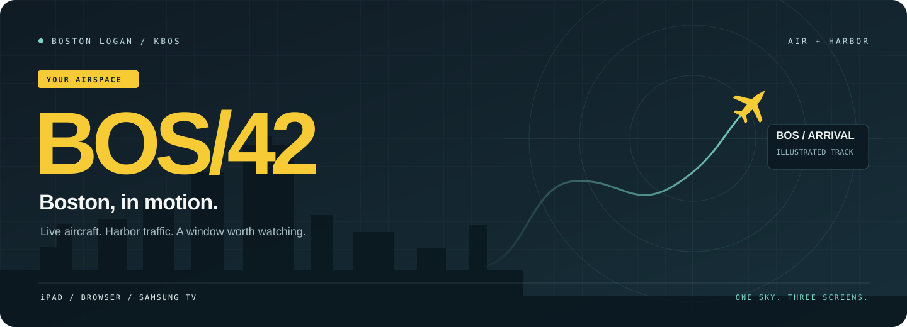
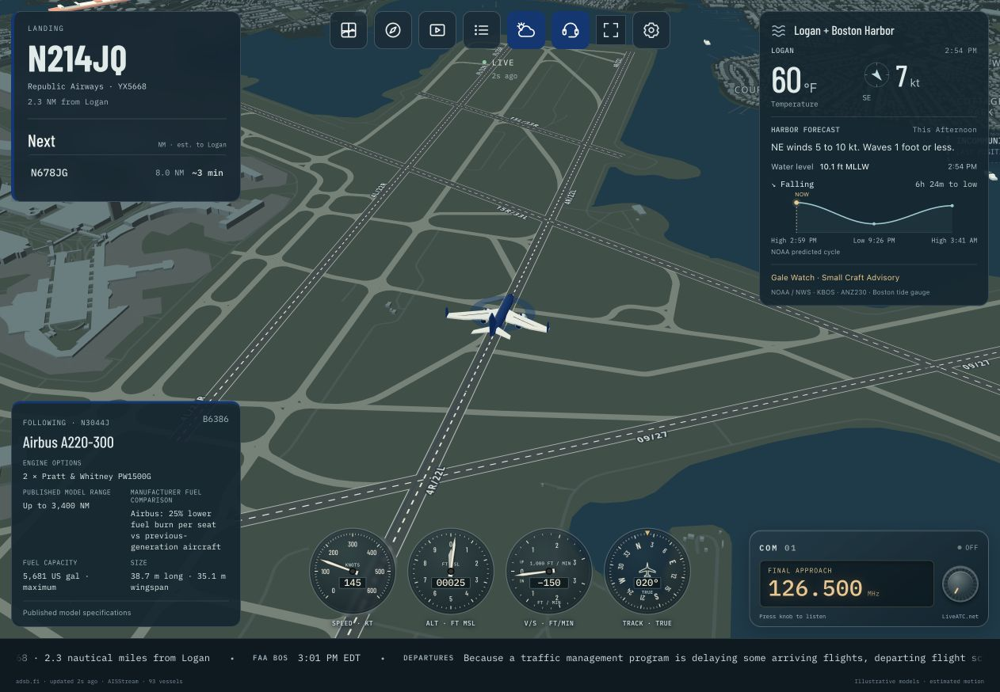
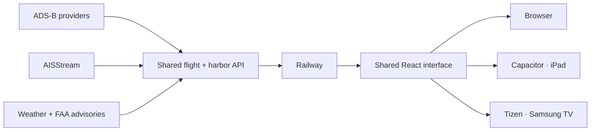

<p align="center">
  
</p>

<p align="center">
  <strong>A live 3D window into Boston Logan and Boston Harbor.</strong><br>
  Built for an iPad by the window, a browser on your desk, or a Samsung TV across the room.
</p>

<p align="center">
  <a href="#the-view">The view</a> ·
  <a href="#run-it">Run it</a> ·
  <a href="#three-screens-one-codebase">Platforms</a> ·
  <a href="#under-the-hood">Architecture</a> ·
  <a href="https://testflight.apple.com/join/r92Mpw9Q">iPad beta</a>
</p>

---

## The view

A jet turns onto final. A ferry crosses the harbor. The next arrival comes into view.

**BOS/42 makes the traffic outside your window something you can explore.** Airline-colored aircraft move over a 3D map of Boston. Tap a flight to follow it, watch the instruments, or let Director find the next scene.

<p align="center">
  
  <br><sub>Live Follow view over Logan. Actual app capture; aircraft models and motion are illustrative.</sub>
</p>

| Mode | What you get |
| --- | --- |
| **Window** | A fixed viewpoint toward Logan, with adjustable direction, height, lens and perspective. |
| **Explore** | Pan, zoom, rotate and tilt around the airport and harbor. |
| **Follow** | A moving camera with groundspeed, altitude, vertical speed and ground-track gauges. |
| **Director** | Automatic scenes, observed approach paths and visits to the traffic board. |
| **Traffic** | Searchable aircraft and harbor lists. Select a row to follow its subject. |

### More than dots on a map

- **Aircraft with character.** Shared 3D jet, propeller and helicopter models, operating-airline colors, and an offline aircraft guide with silhouettes and specifications.
- **The harbor, too.** AIS vessel positions, reported names, vessel types, navigation status, destinations and motion gauges.
- **Context at a glance.** Logan weather, harbor forecasts, predicted tides and FAA airport advisories.
- **Arrival watching.** Automatic flight selection, a compact landing queue and recent observed approach trails.
- **Flight stories.** Patterns from previously observed visits, including operating days and available same-tail departures.
- **A view that moves with you.** Optional iPad motion controls and window alignment. Samsung TV remote controls for the big screen.
- **A little atmosphere.** A compact ATC radio and optional spotting cues for nearby aircraft worth a look.

> **For watching, not navigation.** Aircraft models are illustrative. Motion between reports is estimated. “Likely arrival” describes observed movement, not an assigned runway or an ATC clearance. Interrupted feeds are marked, and old positions stop moving.

## Run it

You need **Node.js 22+** and npm.

```sh
npm ci
npm run dev
```

Open **[localhost:4242](http://localhost:4242)**. The development server serves both the interface and API. Client edits reload automatically; server edits restart the feed service.

For a production browser build:

```sh
npm run build
npm start
```

The local browser preview depends on this server staying up. Installed iPad and TV apps bundle their own interface and fetch data from Railway, so the development Mac can be off. All versions need internet access for live feeds and map assets.

### Make the window yours

Camera and display preferences are saved on the device. To set private defaults for your own builds:

```sh
cp src/window.example.json src/window.local.json
```

Edit the local file’s latitude, longitude, altitude, bearing, zoom and tilt. It is ignored by Git; a fresh clone defaults to the public Logan Airport location.

**Local settings are still included in app builds.** Use this file for viewing preferences, never credentials.

## Three screens, one codebase

### iPad

```sh
cp .env.deploy.example .env.deploy.local  # Set API_BASE_URL and APPLE_TEAM_ID
npm run ios:sync
npm run ios:open
```

Open the existing **App** scheme in Xcode, select your Apple developer team, and build for an iPad. For TestFlight, archive and distribute through App Store Connect. The existing app uses bundle ID `us.torrez.bos42`.

[Join the iPad beta](https://testflight.apple.com/join/r92Mpw9Q) · [iPad setup and deployment](IPAD.md)

The public beta requires an active, approved TestFlight build. Native target: **iPadOS 16+**.

### Samsung Tizen TV

```sh
npm run build:tizen
npm run deploy:tizen  # Uses TV_HOST and TIZEN_SIGNING_PROFILE from .env.deploy.local
```

Deployment requires a developer-enabled Samsung TV, Tizen CLI tools and a valid Samsung signing profile. Set `TV_HOST` and `TIZEN_SIGNING_PROFILE` in `.env.deploy.local`. The SDK defaults to `~/tizen-studio`; `TIZEN_SDK_PATH` or `--sdk` overrides it. Command-line `--host` and `--profile` override environment defaults. App ID: `BOS42TV001.BOS42`.

[TV setup and release commands](TV.md)

### Railway API

The root `Dockerfile` builds the backend with its own minimal dependency set. For a Git-connected service, use the repository root and root Dockerfile; configure the health check as `/api/health`. Preserve the `/data` volume when using persistent flight-story history.

For an explicit API-only CLI upload:

```sh
npm run check:railway
npm run deploy:railway  # Uses the Railway project, service and environment variables
```

The staging check verifies relative imports, excludes frontend and native directories, and checks that the root and staged Dockerfiles agree. `.dockerignore` also limits the root Docker build context to backend source and dependencies.

The API health endpoint is `<API_BASE_URL>/api/health`. See [deployment instructions](IPAD.md#deploy-server-changes).

## Under the hood



**React + TypeScript** handle the interface. **MapLibre GL** renders Boston. **Three.js** draws and picks aircraft and vessels. **Node + Express** share the live feeds, caches and observation history across viewers.

```text
bos42/
├── src/                 Shared interface, cameras and 3D layers
├── shared/              Flight, vessel, motion and selection logic
├── server/              Live feeds, APIs, caching and history
├── ios/                 Capacitor / Xcode iPad project
├── tizen/               Samsung TV manifest
├── deploy/railway/      API dependency manifest and staging config
├── scripts/             Build, verification and deployment tools
├── tests/               Automated checks and development previews
└── docs/                Field guide and README artwork
```

The two npm lockfiles are intentional: the root includes interface and native build tools; `deploy/railway/` contains only API runtime dependencies.

## Configuration

Copy `.env.deploy.example` to **`.env.deploy.local`** and fill it in once. Build and release scripts read this ignored file automatically; process environment variables override file values. Keep the file local. Browser development continues to use its same-origin API.

| Deployment variable | Used by |
| --- | --- |
| `API_BASE_URL` | Shared HTTPS backend origin for iPad and Tizen builds. |
| `RAILWAY_PROJECT_ID`, `RAILWAY_SERVICE_ID`, `RAILWAY_ENVIRONMENT` | `npm run deploy:railway` |
| `APPLE_TEAM_ID` | `npm run configure:ios` (also run by `ios:sync` and `ios:open`) |
| `TV_HOST`, `TIZEN_SIGNING_PROFILE`, `TIZEN_SDK_PATH` | `npm run deploy:tizen` |

The iOS configuration step generates ignored `ios/signing.local.xcconfig`, which Xcode reads for Debug and Release. Certificate passwords remain in Keychain. Optional `.env.native.local` and `.env.tizen.local` files can set `VITE_API_BASE_URL` to override the shared URL for one target.

| Setting | Where it belongs | Purpose |
| --- | --- | --- |
| `VITE_API_BASE_URL` | Platform build environment | Optional override of `API_BASE_URL`. Public in the compiled app. |
| `AISSTREAM_API_KEY` | Railway variables / local `.env.harbor.local` | Enables the server’s harbor feed. |
| `AEROAPI_KEY` | Server environment | Optional FlightAware schedule integration. Missing configuration stays explicit. |
| `AEROAPI_DAILY_REQUEST_LIMIT` | Server environment | AeroAPI request budget; defaults to 20 per UTC day per server process. |
| `FLIGHT_STORY_PATH` | Server environment | Optional history persistence. Railway’s `/data` bootstrap configures this automatically. |
| `PORT`, `HOST` | Server environment | Bind address; defaults to port `4242` on `0.0.0.0`. |

**Anything prefixed `VITE_` is client-visible.** Provider keys stay on the server. Environment files, signing material, personal window defaults, deployment records and private notes are excluded by `.gitignore`.

## Keep it flying

```sh
npm run check       # Tests + browser, native and TV builds + Railway staging
npm test            # Automated behavior checks
npm run typecheck   # TypeScript only
npm run check:live -- 30
```

GitHub Actions runs the full check on pushes and pull requests. `check:live` samples a running API and writes aggregate reports under ignored `artifacts/`; it does not store flight identities or coordinates.

Native signing, TestFlight submissions and TV installation are explicit release steps. Automated checks complement physical-device testing for touch, motion, audio and performance.

## The data behind the view

| Source | Used for |
| --- | --- |
| [ADSB.lol](https://www.adsb.lol/docs/open-data/api/) / [adsb.fi](https://opendata.adsb.fi/) | Public aircraft positions and telemetry; primary and fallback feeds. |
| [AISStream](https://aisstream.io/documentation/) | Available Boston Harbor vessel reports. |
| [adsbdb](https://github.com/mrjackwills/adsbdb) | Callsign and published-route metadata. |
| [OpenFreeMap](https://openfreemap.org/) / [OpenMapTiles](https://openmaptiles.org/) / [OpenStreetMap](https://www.openstreetmap.org/copyright) | Basemap, geography and buildings. |
| NOAA / NWS / FAA | Weather, tides and airport advisories. |
| [FlightAware AeroAPI](https://www.flightaware.com/commercial/aeroapi/) | Optional schedule and journey details. |
| [LiveATC](https://www.liveatc.net/) | Direct radio playback. |

Aircraft feed availability, reporting intervals and provider coverage vary. Published routes can be missing or outdated. Vessel destinations and ETAs are crew-entered. Schedule details require the optional provider; unknown data remains unavailable.

Provider attribution and usage terms apply. LiveATC playback uses the provider’s stream directly; provider permission has not been obtained. Review [LiveATC’s terms](https://www.liveatc.net/legal/) before broader distribution.

[Field guide: feed behavior, motion and history](docs/field-guide.md) · [Aircraft guide implementation](AIRCRAFT-INFO.md)

---

<p align="center"><strong>Find a window. Pick a plane. Watch Boston move.</strong></p>
